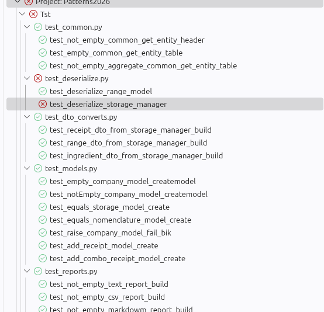

# Письмо

Привет, бро! 
Дела у нас идут в году, однако мы постоянно нуждаемся в твоей экспертной оценке.
Команда успешно выполнена работы по десериализации, однако, Заказчик нам добавил **особый** тест

Суть теста заключается в том, чтобы все выгрузить и затем загрузить повторно.
Данный тест сейчас "падает". Однако, данные при десериализации возвращаются.

Необходимо:
- Найти и устанить причину ошибки в теста не меняя тест.
- Провести анализ и предложить улучшение архитектуры текущего решения.
- Создать UML диаграмму с описанием взаимосвязей при процессе десериализации данных.
- Провести рефакторинг процесса десериализации.

